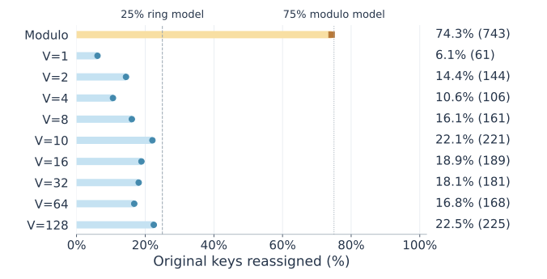
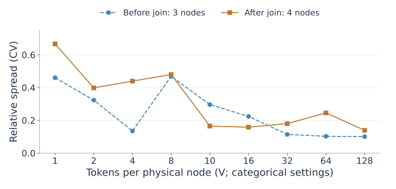
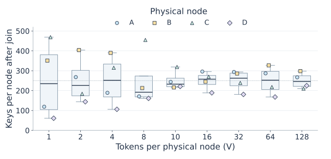
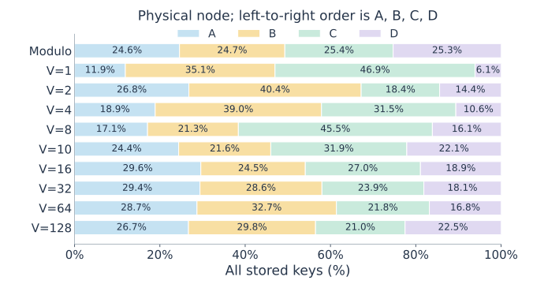
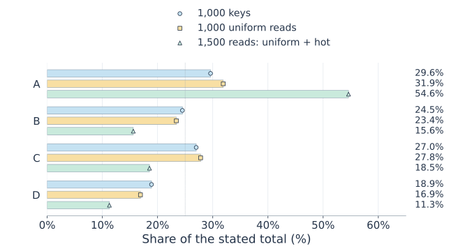
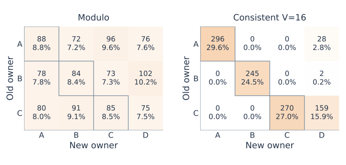
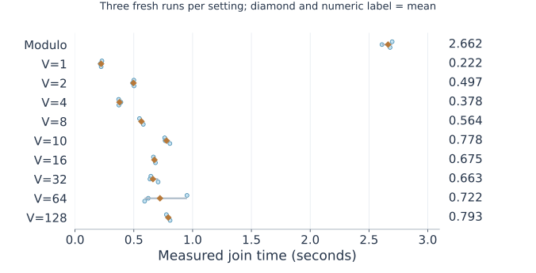

# Measured framework results

<!-- navigation:start -->
[Project home](../README.md) / [Documentation map](README.md)
<!-- navigation:end -->

<!-- contents:start -->
On this page: [Same keys, additional hot traffic](#same-keys-additional-hot-traffic) · [Membership cost and verification](#membership-cost-and-verification) · [Reproduce and trace](#reproduce-and-trace)
<!-- contents:end -->

Thirty fresh WSL clusters: modulo and nine consistent-hash settings, three runs each. The same 1,000 key/value pairs and uniform-read sequence are used throughout. Order is randomized within each round using seed 3010. Placement repeats are deterministic; timing repeats are not independent token-layout samples.

| Setting | Before A/B/C | After A/B/C/D | Max/min after | CV after | Reassigned | Value failures |
|---|---|---|---:|---:|---:|---:|
| Modulo | 332/337/331 | 246/247/254/253 | 1.033 | 0.014 | 743 (74.3%) | 0 |
| Consistent V=1 | 119/412/469 | 119/351/469/61 | 7.689 | 0.666 | 61 (6.1%) | 0 |
| Consistent V=2 | 382/434/184 | 268/404/184/144 | 2.806 | 0.398 | 144 (14.4%) | 0 |
| Consistent V=4 | 280/390/330 | 189/390/315/106 | 3.679 | 0.439 | 106 (10.6%) | 0 |
| Consistent V=8 | 202/245/553 | 171/213/455/161 | 2.826 | 0.480 | 161 (16.1%) | 0 |
| Consistent V=10 | 323/218/459 | 244/216/319/221 | 1.477 | 0.165 | 221 (22.1%) | 0 |
| Consistent V=16 | 324/247/429 | 296/245/270/189 | 1.566 | 0.158 | 189 (18.9%) | 0 |
| Consistent V=32 | 379/335/286 | 294/286/239/181 | 1.624 | 0.180 | 181 (18.1%) | 0 |
| Consistent V=64 | 321/380/299 | 287/327/218/168 | 1.946 | 0.245 | 168 (16.8%) | 0 |
| Consistent V=128 | 317/380/303 | 267/298/210/225 | 1.419 | 0.139 | 225 (22.5%) | 0 |

More V does not guarantee improvement at every step for these fixed IDs. The random-ring 25% reference averages over equal-capacity random layouts, not this particular ring.

The L01 box view contains four physical node counts at each V, with every node marked. The dotted reference is 250 keys per node. It is a finite population description, not uncertainty over machines or token layouts.

## Same keys, additional hot traffic

| Setting | Hot owner | Uniform A/B/C/D (1,000 reads) | After extra hot reads (1,500 reads) | Request max/min after |
|---|---|---|---|---:|
| Modulo | C | 260/242/244/254 | 260/242/744/254 | 3.074 |
| Consistent V=1 | B | 125/347/458/70 | 125/847/458/70 | 12.100 |
| Consistent V=2 | B | 284/388/181/147 | 284/888/181/147 | 6.041 |
| Consistent V=4 | B | 194/369/333/104 | 194/869/333/104 | 8.356 |
| Consistent V=8 | C | 180/191/468/161 | 180/191/968/161 | 6.012 |
| Consistent V=10 | A | 246/193/358/203 | 746/193/358/203 | 3.865 |
| Consistent V=16 | A | 319/234/278/169 | 819/234/278/169 | 4.846 |
| Consistent V=32 | A | 284/299/260/157 | 784/299/260/157 | 4.994 |
| Consistent V=64 | A | 295/337/229/139 | 795/337/229/139 | 5.719 |
| Consistent V=128 | A | 276/308/225/191 | 776/308/225/191 | 4.063 |

All 500 additional requests reach the hot key’s owner, and key counts remain unchanged. Counters reset after loading, migration and exhaustive verification; inventory and migration do not enter client counters.

Matrix rows are old owners and columns are new owners. Cell percentages divide by all 1,000 original keys. Modulo may move keys between old nodes; a fixed-token consistent join sends every changed key to D.

## Membership cost and verification

| Setting | Acknowledged / verified | Join mean ± sample SD (s) | Observed range (s) | Estimated serialized item bytes |
|---|---:|---:|---:|---:|
| Modulo | 743 / 743 | 2.662 ± 0.046 | 2.610–2.697 | 39,776 |
| Consistent V=1 | 61 / 61 | 0.222 ± 0.007 | 0.214–0.229 | 3,259 |
| Consistent V=2 | 144 / 144 | 0.497 ± 0.007 | 0.489–0.502 | 7,694 |
| Consistent V=4 | 106 / 106 | 0.378 ± 0.011 | 0.371–0.391 | 5,677 |
| Consistent V=8 | 161 / 161 | 0.564 ± 0.016 | 0.548–0.581 | 8,632 |
| Consistent V=10 | 221 / 221 | 0.778 ± 0.025 | 0.762–0.807 | 11,844 |
| Consistent V=16 | 189 / 189 | 0.675 ± 0.009 | 0.667–0.684 | 10,124 |
| Consistent V=32 | 181 / 181 | 0.663 ± 0.038 | 0.637–0.707 | 9,712 |
| Consistent V=64 | 168 / 168 | 0.722 ± 0.200 | 0.592–0.952 | 9,005 |
| Consistent V=128 | 225 / 225 | 0.793 ± 0.016 | 0.777–0.808 | 12,041 |

Counts and elapsed seconds are measured. Item bytes are calculated from UTF-8 JSON logical items, not captured network traffic. The timer includes preparation through source cleanup and excludes the independent exhaustive read afterward. No artificial demonstration pause is used. Standard deviations describe three local runs, not confidence intervals or WAN performance.

Every run verifies all 1,000 original values and checks one physical host matching the router’s owner. Reassigned counts equal acknowledged and verified destination counts. During migration, the separate rehearsal demonstrates readable Gets and rejected Puts. No replication result is claimed.

Each circle is one fresh run; the diamond marks its mean. All thirty timings are shown. Repeated runs use the same deterministic layout.

## Reproduce and trace

`bash tools/reproduce.sh` regenerates the evidence. Raw cases, dataset/request digests, process PIDs, randomized schedule and source hashes are in `results/framework/`. The [API reference](api.md), [math definitions](metrics.md) and [scope map](scope.md) explain contracts and assumptions. Legacy results are excluded from the active tree and retained only in local Git history.

<!-- reading:start -->
[Documentation map](README.md) · Previous: [Experiment design](experiment-design.md) · Next: [Demonstration](demo.md)
<!-- reading:end -->
