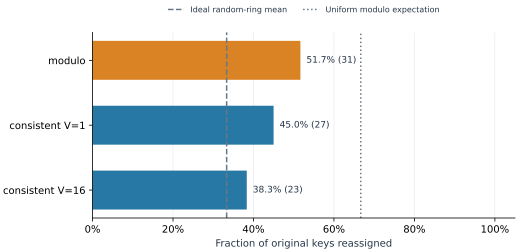
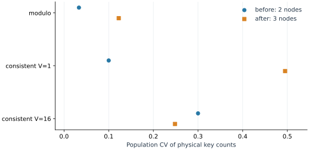
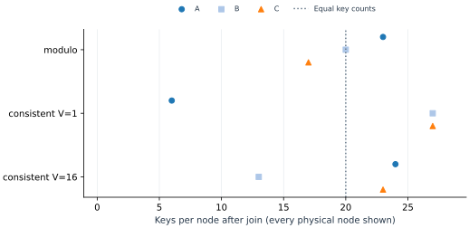
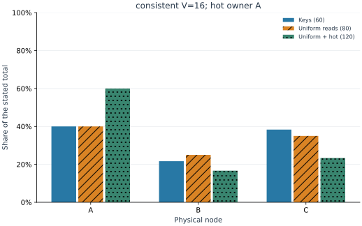
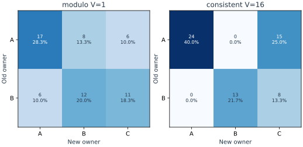
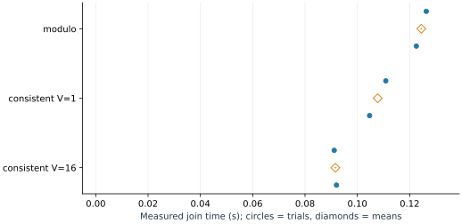

# Local study results

6 fresh-process trials; 60 keys; 2 initial nodes and one join to C.

Question: how do placement policy and token count affect movement, key balance, and concentration of reads?

| Policy | V | CV before | CV after | Max/min after | Moved | Join mean (s) | Sample SD (s) | Min–max (s) |
|---|---:|---:|---:|---:|---:|---:|---:|---:|
| modulo | 1 | 0.033 | 0.122 | 1.353 | 51.7% | 0.124 | 0.003 | 0.123–0.126 |
| consistent | 1 | 0.100 | 0.495 | 4.500 | 45.0% | 0.108 | 0.004 | 0.105–0.111 |
| consistent | 16 | 0.300 | 0.248 | 1.846 | 38.3% | 0.092 | 0.001 | 0.091–0.092 |

## Observed comparisons

The smallest post-join key-count CV among the exercised settings is 0.122 (modulo V=1). This ranks these fixed layouts only; movement and timing remain separate tradeoffs.

Consistent-hash settings moved 38.3%–45.0% of keys; every changed owner is the joining node.

Modulo moved 51.7% of keys. Its transfer matrix shows whether moves also occurred between old nodes.

modulo V=1: the hot key belongs to B; that node's share of observed reads changes from 36.2% to 57.5%, while its stored-key share remains 33.3%.

consistent V=1: the hot key belongs to B; that node's share of observed reads changes from 45.0% to 63.3%, while its stored-key share remains 45.0%.

consistent V=16: the hot key belongs to A; that node's share of observed reads changes from 40.0% to 60.0%, while its stored-key share remains 40.0%.

## Reading these results

Every trial checked the original values and exactly one correctly placed physical copy. Recorded transfer counts agree with changed owners. These checks apply to the exercised runs and the stated no-data-loss assumptions.

The workload sends 80 sampled uniform reads, then 40 extra reads to the first dataset key. All added reads reach that key's owner; key counts stay fixed. This measures request distribution, not throughput.

The ideal exchangeable-token model predicts mean movement of 1/3 for consistent hashing across random layouts. The observations use fixed IDs; differences from this reference are expected.

Inserting one sorted ID gives the uniform-residue modulo reference 2/3. It is an expectation, not an exact finite-key target.

Repeated processes keep the same placement and dataset. Timing means, ranges and sample SD describe this local execution; they are not confidence intervals over layouts, hardware, networks, or production workloads. One trial has no sample SD, shown as n/a. An empty-node max/min ratio is also n/a.

Increasing V need not improve every individual fixed layout. The single-owner design cannot split one hot key. Estimated serialized item bytes exclude HTTP framing, verification and cleanup traffic.

Source hashes match this checkout: True. Raw trials and environment.json remain the evidence; the summary is derived from them. Hashes detect accidental changes, not malicious rewriting of both data and receipts.

## Figures

Every setting; finite-key moved fractions with ideal-model references. References are expectations under the assumptions above.

Every setting; population CV across physical nodes before and after joining. These points describe fixed placements, not replicate uncertainty.

Every setting and physical node after joining; the reference line is equal key counts.

Illustrative full node distribution: consistent V=16 when present, otherwise the first consistent setting or modulo. Each series uses its own stated total; all settings are reported in the text and raw data.

Illustrative modulo matrix when present and the same request-figure setting. Each cell is a count and fraction of all original keys, including stayed keys on the diagonal. Every setting has a raw matrix.

Every setting and all 2 fresh-process timing repetitions; circles are individual observations and open diamonds are means. No inferential error bars are used.

