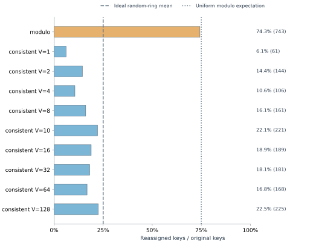
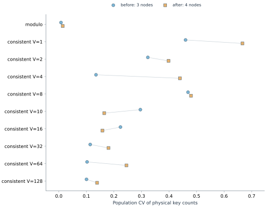
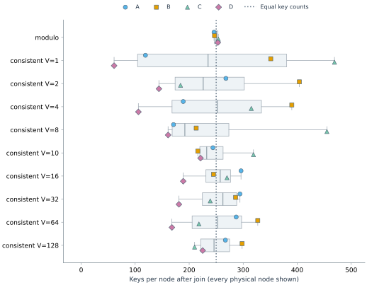
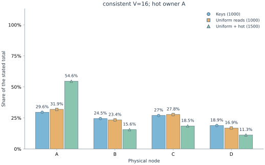
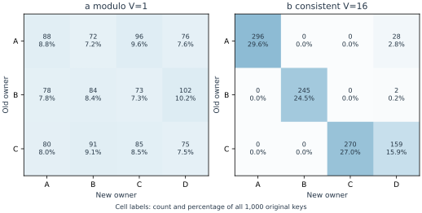
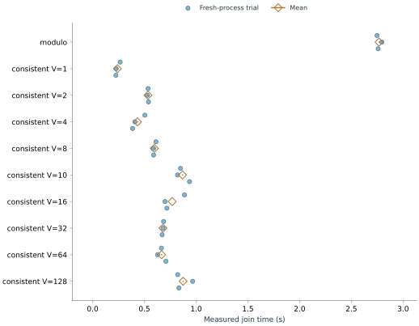

# Local study results

30 fresh-process trials; 1000 keys; 3 initial nodes and one join to D.

Question: how do placement policy and token count affect movement, key balance, and concentration of reads?

| Policy | V | CV before | CV after | Max/min after | Moved | Join mean (s) | Sample SD (s) | Min–max (s) |
|---|---:|---:|---:|---:|---:|---:|---:|---:|
| modulo | 1 | 0.008 | 0.014 | 1.033 | 74.3% | 2.767 | 0.024 | 2.748–2.794 |
| consistent | 1 | 0.460 | 0.666 | 7.689 | 6.1% | 0.239 | 0.023 | 0.225–0.266 |
| consistent | 2 | 0.323 | 0.398 | 2.806 | 14.4% | 0.534 | 0.006 | 0.528–0.539 |
| consistent | 4 | 0.135 | 0.439 | 3.679 | 10.6% | 0.433 | 0.063 | 0.386–0.505 |
| consistent | 8 | 0.469 | 0.480 | 2.826 | 16.1% | 0.596 | 0.014 | 0.588–0.612 |
| consistent | 10 | 0.296 | 0.165 | 1.477 | 22.1% | 0.868 | 0.061 | 0.820–0.936 |
| consistent | 16 | 0.224 | 0.158 | 1.566 | 18.9% | 0.768 | 0.104 | 0.699–0.888 |
| consistent | 32 | 0.114 | 0.180 | 1.624 | 18.1% | 0.679 | 0.007 | 0.672–0.686 |
| consistent | 64 | 0.103 | 0.245 | 1.946 | 16.8% | 0.667 | 0.040 | 0.627–0.708 |
| consistent | 128 | 0.100 | 0.139 | 1.419 | 22.5% | 0.874 | 0.080 | 0.822–0.966 |

## Placement and transfer evidence

Counts are physical stored keys. Every row uses the same original dataset. Copied and verified count acknowledged destination writes and read-back checks; later exhaustive verification also checks every original value and exactly one correct physical host.

| Setting | Before (keys) | After (keys) | Reassigned keys | Copied / verified | Estimated item bytes |
|---|---|---|---:|---:|---:|
| modulo V=1 | A=332; B=337; C=331 | A=246; B=247; C=254; D=253 | 743 (74.3%) | 743 / 743 | 39,776 |
| consistent V=1 | A=119; B=412; C=469 | A=119; B=351; C=469; D=61 | 61 (6.1%) | 61 / 61 | 3,259 |
| consistent V=2 | A=382; B=434; C=184 | A=268; B=404; C=184; D=144 | 144 (14.4%) | 144 / 144 | 7,694 |
| consistent V=4 | A=280; B=390; C=330 | A=189; B=390; C=315; D=106 | 106 (10.6%) | 106 / 106 | 5,677 |
| consistent V=8 | A=202; B=245; C=553 | A=171; B=213; C=455; D=161 | 161 (16.1%) | 161 / 161 | 8,632 |
| consistent V=10 | A=323; B=218; C=459 | A=244; B=216; C=319; D=221 | 221 (22.1%) | 221 / 221 | 11,844 |
| consistent V=16 | A=324; B=247; C=429 | A=296; B=245; C=270; D=189 | 189 (18.9%) | 189 / 189 | 10,124 |
| consistent V=32 | A=379; B=335; C=286 | A=294; B=286; C=239; D=181 | 181 (18.1%) | 181 / 181 | 9,712 |
| consistent V=64 | A=321; B=380; C=299 | A=287; B=327; C=218; D=168 | 168 (16.8%) | 168 / 168 | 9,005 |
| consistent V=128 | A=317; B=380; C=303 | A=267; B=298; C=210; D=225 | 225 (22.5%) | 225 / 225 | 12,041 |

Estimated item bytes are calculated UTF-8 JSON logical-item sizes, not measured network traffic. Transfer counts and elapsed join seconds are measured. The three quantities answer different questions.

## Observed comparisons

The smallest post-join key-count CV among the exercised settings is 0.014 (modulo V=1). This ranks these fixed layouts only; movement and timing remain separate tradeoffs.

Consistent-hash settings moved 6.1%–22.5% of keys; every changed owner is the joining node.

## Fixed-ring coverage and observed movement

The joining node captures the integer predecessor intervals of its new tokens. Its exact coverage is conditional on this particular ring; the finite dataset need not fill those intervals in precisely the same proportion. The random-layout mean answers a separate question.

| Setting | Joining-node hash-space coverage | Observed reassigned fraction | Ideal random-layout mean |
|---|---:|---:|---:|
| consistent V=1 | 7.27% | 6.1% | 25.0% |
| consistent V=2 | 14.64% | 14.4% | 25.0% |
| consistent V=4 | 10.09% | 10.6% | 25.0% |
| consistent V=8 | 13.39% | 16.1% | 25.0% |
| consistent V=10 | 19.08% | 22.1% | 25.0% |
| consistent V=16 | 16.53% | 18.9% | 25.0% |
| consistent V=32 | 17.61% | 18.1% | 25.0% |
| consistent V=64 | 18.72% | 16.8% | 25.0% |
| consistent V=128 | 24.58% | 22.5% | 25.0% |
Modulo moved 74.3% of keys. Its transfer matrix shows whether moves also occurred between old nodes.

## Hot-key request concentration

Background requests sample the same 1000 keys uniformly. After 1000 background reads, the run adds 500 reads to the first key. Stored-key counts remain unchanged. Each request-share column uses its own stated total.

| Setting | Hot owner | Stored-key share | Background reads | Background + extra hot reads |
|---|---|---:|---:|---:|
| modulo V=1 | C | 25.4% | 244 / 1000 (24.4%) | 744 / 1500 (49.6%) |
| consistent V=1 | B | 35.1% | 347 / 1000 (34.7%) | 847 / 1500 (56.5%) |
| consistent V=2 | B | 40.4% | 388 / 1000 (38.8%) | 888 / 1500 (59.2%) |
| consistent V=4 | B | 39.0% | 369 / 1000 (36.9%) | 869 / 1500 (57.9%) |
| consistent V=8 | C | 45.5% | 468 / 1000 (46.8%) | 968 / 1500 (64.5%) |
| consistent V=10 | A | 24.4% | 246 / 1000 (24.6%) | 746 / 1500 (49.7%) |
| consistent V=16 | A | 29.6% | 319 / 1000 (31.9%) | 819 / 1500 (54.6%) |
| consistent V=32 | A | 29.4% | 284 / 1000 (28.4%) | 784 / 1500 (52.3%) |
| consistent V=64 | A | 28.7% | 295 / 1000 (29.5%) | 795 / 1500 (53.0%) |
| consistent V=128 | A | 26.7% | 276 / 1000 (27.6%) | 776 / 1500 (51.7%) |

## Reading these results

Every trial checked the original values and exactly one correctly placed physical copy. Recorded transfer counts agree with changed owners. These checks apply to the exercised runs and the stated no-data-loss assumptions.

The workload sends 1000 sampled uniform reads, then 500 extra reads to the first dataset key. All added reads reach that key's owner; key counts stay fixed. This measures request distribution, not throughput.

The ideal exchangeable-token model predicts mean movement of 1/4 for consistent hashing across random layouts. The observations use fixed IDs; differences from this reference are expected.

Inserting one sorted ID gives the uniform-residue modulo reference 3/4. It is an expectation, not an exact finite-key target.

Repeated processes keep the same placement and dataset. Timing means, ranges and sample SD describe this local execution; they are not confidence intervals over layouts, hardware, networks, or production workloads. One trial has no sample SD, shown as n/a. An empty-node max/min ratio is also n/a.

Increasing V need not improve every individual fixed layout. The single-owner design cannot split one hot key. Estimated serialized item bytes exclude HTTP framing, verification and cleanup traffic.

Source hashes match this checkout: True. Raw trials and environment.json remain the evidence; the summary is derived from them. Hashes detect accidental changes, not malicious rewriting of both data and receipts.

## Figures

Every setting; finite-key moved fractions with ideal-model references. References are expectations under the assumptions above.

Every setting; population CV across physical nodes before and after joining. These points describe fixed placements, not replicate uncertainty.

Every physical node is marked. The box shows median and interquartile range across physical-node counts; whiskers show their full minimum/maximum. This finite-population summary is not a confidence interval or timing uncertainty. The reference line is equal key counts.

Illustrative full node distribution: consistent V=16 when present, otherwise the first consistent setting or modulo. Each series uses its own stated total; all settings are reported in the text and raw data.

Illustrative modulo matrix when present and the same request-figure setting. Each cell is a count and fraction of all original keys, including stayed keys on the diagonal. Every setting has a raw matrix.

Every setting and all 3 fresh-process timing repetitions; circles are individual observations and open diamonds are means. No inferential error bars are used.
